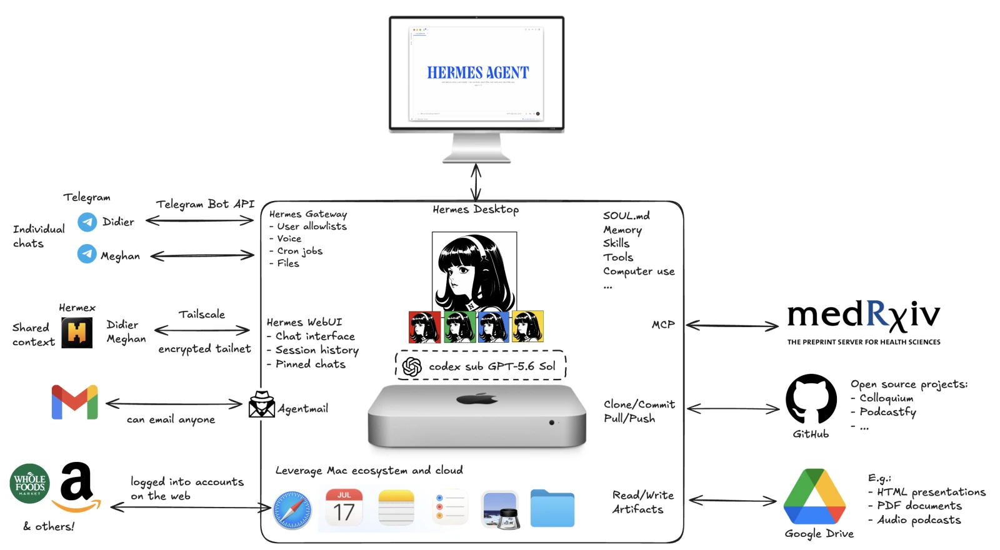
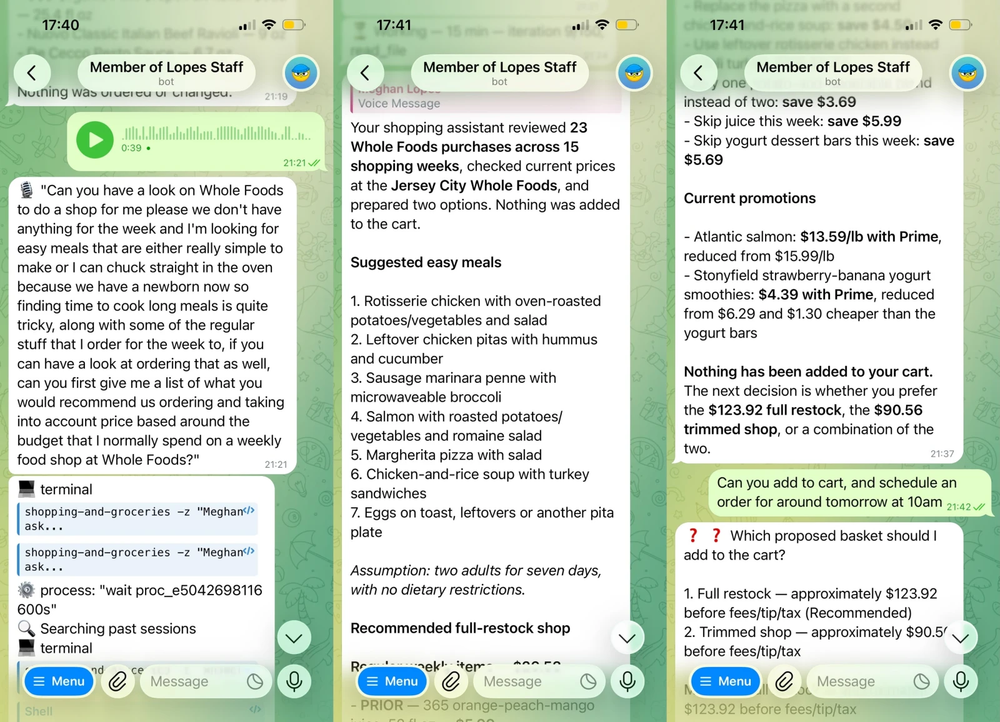

An always-on local agent that runs my wife's and my life from a Mac mini

<!-- truncate -->

Recently I got a Mac mini.

I’ve been wanting to tinker with OpenClaw for a long time, but I knew I could get deep into this as I get easily excited by technology.

At the same time I was reading more and more about Hermes agent - and even integrated it into OpenBB Workspace a few months back:

[https://x.com/didier_lopes/status/2052610001424830913](https://x.com/didier_lopes/status/2052610001424830913)

But I only scratched the surface then.

In reality, I’ve never felt like this this much in my life:

<p align="center">
    
</p>

<br />

By the end of this post you will understand why…

### Goal

I didn’t want to do something just for the sake of doing it - I wanted to have an overall objective that I’m trying to accomplish.

Recently, my wife and I have been spending more time learning about biology and biotech - but we have no background on the topic. And often were asking the same questions to ChatGPT/Claude. This gave me the perfect opportunity to work on this - as I actually needed something like this, by the end of it you will understand why.

My wife said, and I quote:

> *“Out of all the projects you’ve done over the years, this is by far the most impressive and helpful”*

<br />

There are a few reasons why I needed such a setup; and how it evolved into being more a Chief of Staff of our lives:

- I wanted to have an agent that had full control of a machine - everything from terminal, git, drive, telegram, email, Amazon, & Whole Foods website, …
- This agent would have to have a lot of integrations so that I could continuously expand surface area that it could touch (including MCP connections)
- It needed to be always-on
- I still wanted to have access to its environment if I needed to work on top of some artifacts that it generated directly
- I wanted to have a shared context of work with my wife and I; so the agent could pull threads that she or I started
- Documents that we added into the drive should be available to this agent
- The agent should know who my wife and I are, and be able to communicate with us
- It should be able to have reminders that we can keep updating via text (or even audio!)
- It should be able to produce artifacts such as presentations and audio
- It should be able to leverage whatever LLM we want to use - e.g. codex sub

<br />

And I’m pretty sure that over time there will be many more use cases!

### Architecture

At a high-level, here’s what we are going to walk through:

<p align="center">
    
</p>

<br />

We will talk over each of these components - how they are connected and what we are using it for.

## Local agent and Mac mini capabilities

### Hermes Agent and its harness

I think of **Hermes** as everything else but the model - i.e. the harness.

It assembles the context for each request, retrieves memory, loads the relevant skills, exposes tools, checks permissions, runs the model’s tool-calling loop, and holds the output.

It also decides what happens after a tool call: whether the output needs to be checked, whether another tool is needed, and whether the original request has actually been completed.

The local Hermes installation was ridiculously easy. It’s pretty much one command in [here](https://hermes-agent.nousresearch.com/docs/getting-started/installation). Then you can set up everything else by having the agent doing it itself, and you can use natural language to guide it based on what you want and testing it and double checking that it works.

But the most important thing I did was I installed everything at the root level and gave it permission to do everything. And then just limited the damage it could do based on what I integrated (as you will see soon).

Hermes harness most important (durable) components are:

- *SOUL.md* defines the agent’s personality and tone;
- User memory preserves details on my preferences and what I like/dislike - e.g. distinction between my Telegram user ID vs my wife’s;
- Skills preserve repeatable procedures, such as handling Google Drive, producing diagrams, or managing a shared task list;
- Session history keeps long-running work available after the fact;
- The file system holds the actual objects - Markdown, code, diagrams, audio, rendered artifacts, anything!

<br />

Several local processes provide different ways into this same agent installation.

The Hermes messaging gateway handles Telegram. The community Hermes WebUI provides the backend used by Hermex. The official Hermes Desktop app is a separate native Mac interface backed by the official *hermes serve* process.

In simplified form:

```text
Telegram       → Messaging Gateway ───────┐
Hermex         → Community WebUI ─────────┼→ Hermes Agent
Hermes Desktop → hermes serve ────────────┘
```

<br />

They use the same local Hermes configuration, model credentials, skills, memory, files, and session store when pointed at the same profile. Interface-specific state can still differ, especially between the official Desktop app and the separately maintained community WebUI. But this is what I love about Hermes agent - it’s that this is the tip of the iceberg, if I want to use WhatsApp, Slack, Gmail, … I can. There are few options that I could think of that aren’t supported!

On the Mac mini, the gateway and WebUI run as supervised background services. macOS starts them again after login by default.

The harness also acts as safety boundary. The model does not receive unrestricted direct control of macOS. Hermes mediates file operations, shell commands, browser activity, desktop control, messages, and external API calls. Dangerous actions require approval, and consequential changes are validated before the agent reports success. Although this consumes extra tokens, I love this approach - as my UX is 10x better.

#### Hermes bots

I had one agent doing too many unrelated jobs.

It helped with research, writing, coordinated household work, built apps, and maintained websites. It was mostly fine, but then it started “bleeding” context across unrelated tasks - and the access controls was non-existing. E.g. for coordinating household work, why does the agent need access to GitHub?

And Hermes had just launched [Bot mode](https://hermes-agent.nousresearch.com/docs/user-guide/bot-mode). So I told the agent to go through our entire past threads and user memories and understand which bots we should be creating from it - including personality, moving memories, tools access, etc..

And it suggested we create a few different bots. Basically when there was enough that happened in a certain area to grant the creation of a new bot - it decided to do it, and then we just had to help set up the tools etc associated with that bot.

Each specialist has a canonical Bot Chat: one durable place where its history accumulates. When another conversation needs that specialist, I hand the task over and the result comes back, rather than copying a large pile of context between agents.

This has made it so that context stays relevant. Specialist history persists. The integrations are obvious based on the specialist at hand and reduces risk of an unrelated task touching tooling that it shouldn’t mess with. Very clean!

#### Codex subscription

Given that Hermes agent will touch everything, I wanted it to have access to a frontier model and one that had very generous limits. This kinda narrowed it down to GPT-5.6 Sol; particularly as I had some reset lefts (thank you Tibo!).

One thing that I also like is that I am using my codex subscription, so both my wife and I are leveraging Hermes - but the tokens are coming from a single sub.

Although I depicted OpenAI inside Mac mini, the model doesn’t run there. Inference is remote, so:

```text
Local context and request
↓
Hermes Agent
↓
Codex OAuth
↓
Remote model inference
↓
Reasoning and proposed tool calls
↓
Hermes executes locally
```

<br />

The Mac mini runs the agent, tools, files, sessions, and control layer. Codex provides the intelligence.

The model is good at deciding what kind of work may be required. It can interpret a broad request, identify missing information, plan a sequence of actions, compare evidence, write code, and decide which tool to call next.

For example, the model may decide that a research request needs:

1. A structured preprint search
2. DOI normalization
3. PDF retrieval
4. Text extraction
5. Comparison against previous notes
6. A visual artifact
7. Delivery to another person

<br />

Codex can plan that sequence. Hermes will execute it.

The model can change later without losing the local memory, skills, source files, permissions, and operating standards.

#### Mac ecosystem apps

I could have hosted the agent on a cloud VM. The Mac mini was more useful for the kind of work I wanted.

It is simultaneously:

- An always-on home server
- A persistent file system
- A desktop computer with native applications
- A browser environment with signed-in services
- A development machine
- A place where private artifacts can remain local

<br />

.. and I can just hook up a monitor, keyboard and mouse to it!

The agent can download PDFs from MedRxiv, open it in Preview, and inspect the report in a native window. It can take set shared TODOs in the reminder app and use that for both my wife and I. It can build an application, render it in the browser, and evaluate its rendering. More importantly, it can use Hermes’ computer-use integration to operate applications in the background through macOS accessibility interfaces.

The applications currently useful in the workflow include:

- Finder for local organization
- Preview for PDFs and images
- Terminal for builds, scripts, Git, and validation
- Safari for browser-based tools
- Apple Reminders for the shared family task list
- Native file dialogs and macOS services when no API path exists
- Calendar to check for upcoming appointments or book something

#### Non Mac ecosystem apps

The Mac mini also runs local specialist tools.

Given access to GitHub, I cloned:

- **Colloquium** - converts editable Markdown into HTML presentations.
- **Podcastfy** - converts reviewed two-person scripts into conversational audio.

<br />

The official Hermes Desktop app is another part of this Mac layer. It is a native application for chat, configuration, projects, files, terminals, artifacts, and multiple sessions.

Hermex uses the separate community WebUI. Both point at the same underlying Hermes installation.

And there are probably many more now that I don’t even realize - but I’ve given Hermes the power to download and use them.

### Browser

The awesome thing about it being connected with the browser and you having logged in into that browser, is that you don’t even need an MCP but the agent can just do computer use to control the browser.

Here’s an example of Hermes agent being used to do our weekly shopping. My wife was holding the newborn and hadn’t had the time to sit down to sit and select items, so I told her to leave a voice note to Hermes and see what happened.

And then the only thing I had to do in the end was give it confirmation in the app, just to ensure there’s some protection layer and it doesn’t order by default… but this is the equivalent to --yolo which becomes the default once you gain confidence in the system.

<p align="center">
    
</p>

## People and access channels

The same Hermes is reachable through different interfaces.

Telegram is the quick conversational route. Hermex is the richer mobile workspace. Email gives the agent an identity outside chat platforms. They converge on the same local capabilities, but they do not automatically share one live conversation.

### Telegram

Telegram is the interface I use most often because it has almost no friction.

My wife and I each have a separate private conversation with the same Hermes agent, and the agent knows who is who. Our Telegram identities are explicitly allowlisted, so finding the bot username is not enough to gain access. Each chat has its own session context even though both chats can use the same agent, files, memory, and tools.

```text
Telegram app
↓
Telegram Bot API
↓
Hermes Messaging Gateway
↓
Hermes Agent
```

<br />

The gateway is a long-running background process on the Mac mini. It receives platform events, associates them with the correct chat session, invokes Hermes, and delivers the response back through Telegram. It also handles files, voice messages, scheduled deliveries, and platform-specific commands.

Telegram supports more than text. We can:

- Send voice notes for transcription
- Attach screenshots or documents
- Receive PDFs, HTML, images, audio, and ZIP files
- Ask the agent to send something to the other person
- Add or update tasks using ordinary language
- Receive scheduled reminders or research results

<br />

One of our favorite flows that involves the gateway is the shared task list. Either of us can send a text or voice request such as: “*Remind me to call person X tomorrow*”

Hermes recognizes the task intent and writes it into one shared Apple Reminders list. A morning cron job reads every open item and sends the same list to both Telegram accounts.

Telegram is excellent for point-in-time interactions, but it is less comfortable for browsing a long research history, comparing artifacts, or working across several sessions.

### Hermex

Hermex is the native iPhone client for the community Hermes WebUI.

```text
Hermex on iPhone
↓
Tailscale
↓
Hermes WebUI on the Mac mini
↓
Hermes Agent
```

<br />

Hermex does not connect to the messaging gateway, and it does not connect to the official Hermes Desktop app. It talks to the community WebUI server.

We made the WebUI reachable through our private Tailscale network rather than publishing it on the open internet. Tailscale controls who can reach the network route.

Hermex gives a richer interface than Telegram:

- Session history
- Longer streaming responses (not broken down by messages with 1/7, 2/7, …)
- File and workspace navigation
- Pinned conversations
- Profile and model controls
- Better handling of long-running research threads

<br />

My wife much prefers this interface!

Although the threads are shared by both of us here.

### Hermes Desktop

The official Hermes Desktop app uses a different backend, *hermes serve*. It shares core state with Hermex while retaining separate interface-specific metadata.

I use Hermes desktop much more, particularly when I was installing everything and when I want to actually be controlling the Mac Mini with Hermes.

Something that is cool is that if the WebUI stops, Hermex stops working. But Telegram continues through the gateway, and the official Desktop app continues through its own backend. So there’s redundancy baked in.

### AgentMail

Email gives the agent a durable identity beyond Telegram and Hermex.

We created a dedicated AgentMail inbox, which is an external email service. The local Mac runs the client logic that calls its API:

```text
Hermes on Mac mini
↓
AgentMail API
↓
Dedicated agent inbox
↓
Any email recipient
```

<br />

The crazy thing is that I just asked the agent to create an email account for itself…

[https://x.com/didier_lopes/status/2091625530374210005](https://x.com/didier_lopes/status/2091625530374210005)

The only thing I had to do was to verify a OTP sent to my personal email.

Now my agent has an email that it can use to send/receive emails - I like it so that it can send things I want to read/study/work on to my email and I can kept it in “UNREAD” state to be acted upon.

## External systems and durable artifacts

### GitHub

GitHub is the code and provenance layer.

Several capabilities in the system began as repositories cloned onto the Mac mini:

- Colloquium
- Podcastfy
- The medRxiv MCP server
- Hermes Agent itself
- Local scripts and diagram generators

<br />

Once a repository is local, Hermes can inspect its structure, read its history, modify code, run tests, review the resulting diff, and prepare a commit.

With authenticated Git access, it can also push a reviewed change or open a pull request. Although I haven’t yet done that - just tinkering locally.

The medRxiv MCP is a good example of the value of Git. The original project failed because its scraper hit a Cloudflare challenge, its metadata endpoint returned errors, and its dependency range installed an incompatible SDK. → at least that’s what it told me. 🤷🏽‍♂️ Hermes modified the local clone, replaced the fragile search path, added normalization and tests, and verified the actual MCP transport.

The other side of it is that I can give the agent access to [my personal website](https://github.com/DidierRLopes/my-website) to update books read or books to read; or access to a personal project like [pokemon vault](https://pokvault.com/) and it can fix/add features on the fly.

### Google Drive

Google Drive is our shared artifact library, which we can open on mobile.

Hermes has OAuth access to one approved shared parent folder rather than unrestricted access to every file in the account. The OAuth credentials remain local, and Drive operations stay inside that boundary.

The difference between Drive and local storage is timing. We treat local folders and artifacts as work in progress; and when the artifact is ready to be consumed we push to the drive. An example is that I created a Zero to Hero course on a specific topic and it now lives in a folder in our drive.

### External API/MCP tools (e.g. medRxiv)

This allows us to add any external service that we can think of to Hermes via your typical API or MCP tools, to enhance the tools at its disposal from the get-go. We could even give access to OpenBB Workspace MCP to do financial research - more on this in another post!

In this case, we gave it access to medRxiv which is an external source of health-science preprints.

## How it all comes together

The complete workflow is actually quite clean

```text
Didier or Meg iPhone
↓
Telegram, Hermex, or email
↓
Hermes on the Mac mini
↓
Codex reasoning + local tools
↓
Route to specific Hermes bot maybe
↓
GitHub code, research sources, native Mac applications
↓
Verified local files
↓
Google Drive, Telegram, Hermex, or email delivery
```

<br />

It’s a new world; but I’m excited to keep pushing what’s possible with this.
