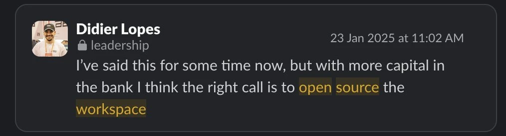

And how I built a voice controlled Pokemon fight that I played against my wife

<!-- truncate -->

Most people prefer thinking in terms of binary as it simplifies things. Like you can either “build” or “buy”. The “buy” option was never about the fact that you would spend money on it, but rather that you were buying a solution that was mature and you could use it almost out-of-the-box.

But with the proliferation of open source and coding agents, the “build” option is now very close to the “buy”. Not only that, but it allows you to go further than the “buy” option does.

What I’m trying to say is that the “buy/build” binary has its days numbered. I believe that (all) software in the future will have to allow you to build on top, and if you want to “buy”, it will rarely be one-size-fits-all software anymore.

This is **what happens when the cost of building software goes to zero.**

I’m not just saying this now. I told my team more than 2 years ago that for us to win we would have to open source our Workspace to enable clients to have full control of their environment, but first we needed to find a way to have a sustainable business model. We didn’t, but I remain convinced of this.

    

 

Anyway, this is a thought I’ve been having for some time.

And in this post I want to give you an example in the gaming industry.

## Emerald Arena

A couple of weeks ago I saw [GBurgardt](https://x.com/germanburgardt/status/2098872053830992370) share [Emerald Arena](https://github.com/GBurgardt/pokemon-emerald-arena), a ROM hack of Pokémon Emerald.

A ROM is the file copy of a game cartridge (Game Boy Advance in this case). A ROM hack is a modified version of that file, and you play it on an emulator (e.g. mGBA), a program that runs GBA games on a computer or a phone. German’s hack keeps the original game but makes the battles real-time.

I downloaded it, played a few fights and was like: “*this is nice, but what if …*”

That’s all it took.

First I gave Charizard Seismic Toss.

[https://x.com/didier_lopes/status/2103307899808186511](https://x.com/didier_lopes/status/2103307899808186511)

Then Gengar to be able to traverse obstacles.

[https://x.com/didier_lopes/status/2103540473088602149](https://x.com/didier_lopes/status/2103540473088602149)

Then I allowed Golem to roll.

[https://x.com/didier_lopes/status/2103657692761850087](https://x.com/didier_lopes/status/2103657692761850087)

I could have kept going, there are so many possible innovations on the attack visuals. But ultimately you are always in the arena.

So **hold on.**

Why do we have a storyline if all I care about is the arena?

That was the thought I had on Saturday before closing my eyes…

## Emerald Arena ONLY

So Sunday morning, the first thing I did when I woke up was to create this Arena mode, which had been brewing in my subconscious overnight.

But the mechanics would have to be different, so I brainstormed with Opus 5.5 how I wanted it to be.

- I wanted to have a selection menu to pick Pokémon where I can see their moves
- I wanted to have up to 6 Pokémon in my party
- I didn’t want everyone to choose the same legendary Pokémon, so we needed to create a “credit” system. Like fantasy football, where you spend credits on better players, except here they are Pokémon. I asked my agent to use its best judgment for this.
    - Ideally you would let it run different battles (COM x COM) with different credit levels being used and then tinker the credits per Pokémon accordingly based on win-rate. But I didn’t want to spend tokens/time on this. Sometimes good enough is good enough.
- I wanted to use my voice to control the pokemon move, so I could feel like Ash Ketchum (or well, Brendan). I thought this would be feasible with Whisper on-device (voice → text) and Typesafe’s Jev model (text → command).
    - Some of these Whisper models are actually quite fast and pretty high quality. It’s so good that I use [OpenSuperWhisper](https://github.com/my-monkeys/OpenSuperWhisper) with a Whisper model as my default voice → text app
    - Jev is TypeSafe’s decision API: you give it a piece of text and the list of actions possible right now, and it picks one, fast. Think of it as System 1 thinking for agents. This was the killer in this case, as it allowed me to map text (from voice) into a set of commands. Not just the moves but also “switch to Charizard” and picking Charizard in the draft.

 

Then I shared this tweet.

[https://x.com/didier_lopes/status/2104203064257228820](https://x.com/didier_lopes/status/2104203064257228820)

This was a couple of back and fourths with the agent, mostly on the UI/UX, but it pretty much one-shotted my request.

But wait, I want to play with my wife…

But we could shout voice commands at the same time, how to handle it? The model has to detect each players’s voice so what if we created that baseline at the start of the fight. And so we did.

Here’s the result:

[https://x.com/didier_lopes/status/2104375192730448093](https://x.com/didier_lopes/status/2104375192730448093)

I was very pleasantly surprised! And that had close to 100k impressions!

So, almost 100k saw my wife kicking my ass on the first real-time pokemon voice controlled fight. Sigh.

Then I saw my friend [David sharing a skill to create videos with Remotion](https://x.com/dzhng/status/2105156858982039929) and I gave this prompt to Opus:

> *"now please install this git@github.com:dzhng/skills.git and use its skills to create an announcement video for this emerald arena mdoe"*

 

This was the output:

[https://x.com/didier_lopes/status/2104394266219073710](https://x.com/didier_lopes/status/2104394266219073710)

Looking back at that Sunday, it made me realize that I would have killed to have this game as a kid. And I thought about my newborn while I was building it, and how we could have fun together.

I can’t wait until she can play games!

## Every game is an adaptation

This made me think further about how games are made.

Very few formats are new anymore. Look at almost any recent game and you can spot the combination of existing games behind it.

For instance, this Emerald Arena is a combination of **Pokémon Emerald** (duh) and **Legacy of Goku II**.

One of my favorite games growing up was **Counter-Strike 1.6**. Here’s a clip of some near-aces I’ve had on different maps:

    <iframe
        src="https://www.youtube.com/embed/ocsJzNJJB50"
        width="800"
        height="400"
    />

 

But even **Counter-Strike** started as a mod for **Half-Life**.

The one I like to play now is **Fortnite**. I usually play it on Sundays with my father-in-law, my brother and sometimes my wife or her brother-in-law. It has become a ritual now.

But when I don’t play Battle Royale with them, I always play this mod called **[Rapid Zero Build 2v2](https://www.fortnite.com/@bullseye/9546-9918-8917)** because it is very fast paced and there’s more “play time” in that mode. I think about it similarly to soccer and indoor soccer (futsal), where I started enjoying the latter more due to the pace of the game and because you are in more contact with the ball.

But even now, on X I see people making very cool games by fusing different ideas together, e.g.:

- **League of Legends** x **Dragon Ball FighterZ**

 

[https://x.com/GamefxAI/status/2106387548486738010](https://x.com/GamefxAI/status/2106387548486738010)

- **Pokémon** x **Minecraft**

 

[https://x.com/MozeTech/status/2106590326634983710](https://x.com/MozeTech/status/2106590326634983710)

- Figure Me Out is a multiplayer FPS where you kill someone by typing the number on their forehead before they read yours. It’s like **Counter-Strike** with **The Typing of the Dead**, with a bit of the party game where everyone can see your card except you.

 

[https://x.com/IndieGameJoe/status/2106413001477890159](https://x.com/IndieGameJoe/status/2106413001477890159)

My view is that most game mechanics have already been invented. What’s left are the edges: *the style, the design, the characters, the storyline, the rules*.

But those edges are what AI can tweak with a single prompt.

## Blockbusters and personal games

So I wonder if gaming splits into two kinds of games with Pareto distribution.

**The first is the blockbusters (most people play these).** Fortnite, Counter-Strike, Minecraft, GTA and the handful of games most people agree on the user experience. Millions of players to match against, lots of capital to support growth of game and a shared culture.

**The second is highly personalizable games (long tail).** These go beyond one person building something for themselves. The audience is you and your immediate friends or a small community. My mod only got really fun once my wife played with me.

Success is different on these. The first is active players; whilst the second is likely how much of power users the small community is.

But then, I wonder if these will connect. Let’s take the Rapid Zero Build 2v2 on Fortnite - it’s built on a blockbuster but it’s a mod that I much more enjoy, and now if I play with my brother during the week - we default to it.

Regardless, I expect that we see many many more mods on blockbuster games. Can’t wait to see what games will exist by the time my daughter can play, and building something with her.

In the meantime, if you want to try the real-time voice controlled pokemon arena - it’s fully open source here: [https://github.com/DidierRLopes/pokemon-emerald-arena/pull/2](https://github.com/DidierRLopes/pokemon-emerald-arena/pull/2)
