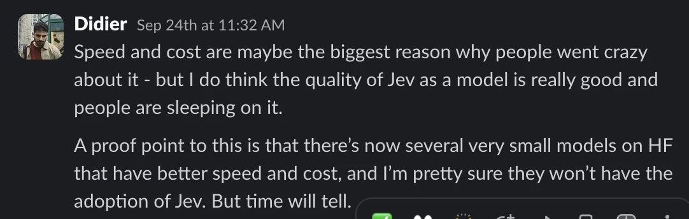
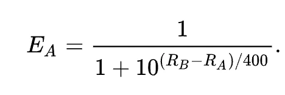
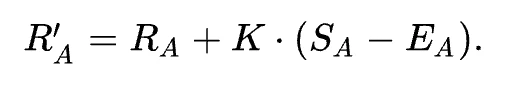
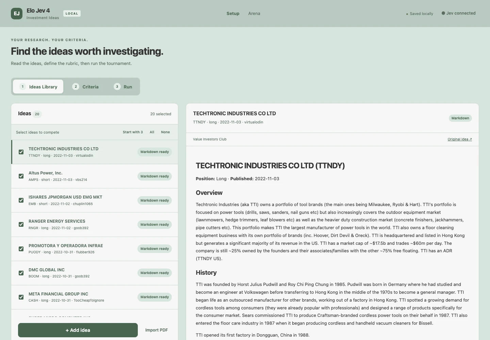
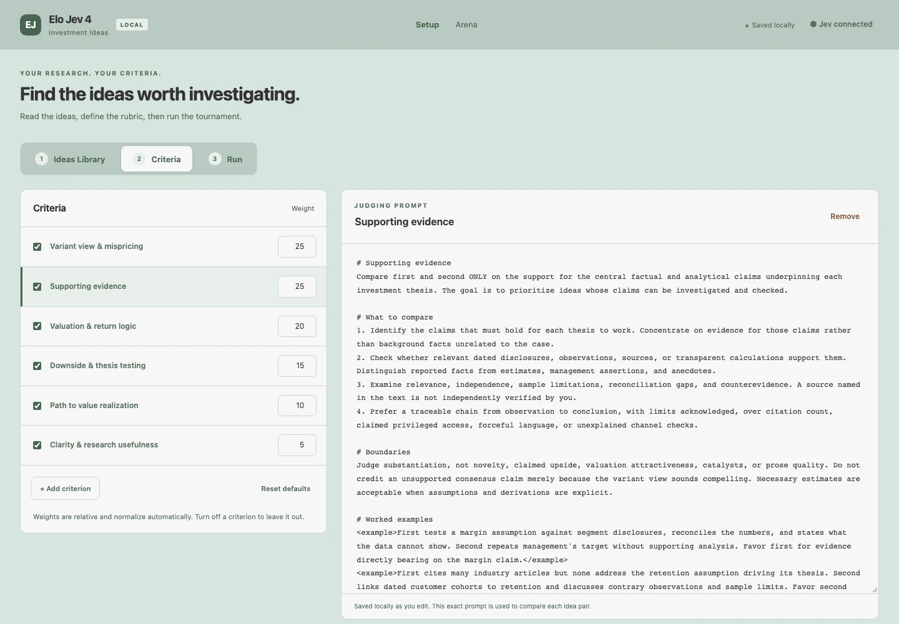
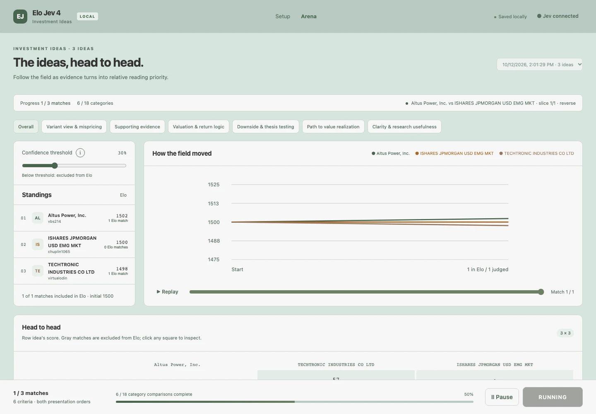
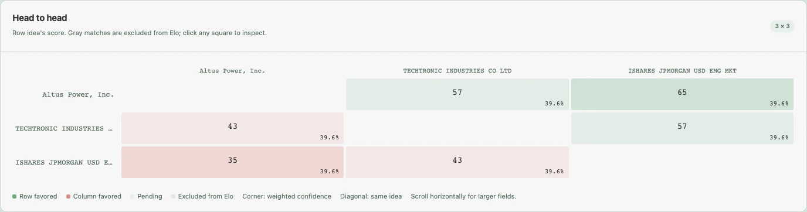
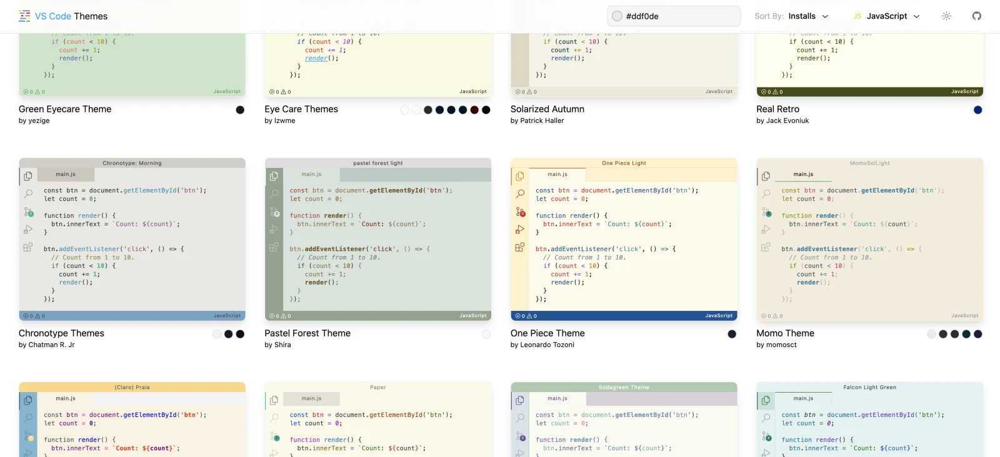

A weekend experiment with Jev and an Elo leaderboard to find the ideas worth digging into.

<!-- truncate -->

I’ve now been building financial software for almost 6 years. But the world was different when I started doing so. Although some may say that we’ve been ahead of the curve a few times, e.g. when we came up with [AskOBB](https://www.youtube.com/watch?v=fK53ChIiKlM) which converted natural language into commands to retrieve data and piped these together.

But recently, with latest model, and given that I was winding down OpenBB - I tried to build a multi-agent system that could generate an investment pitch.

The idea was to see if I could automate a specific analyst workflow, as much as possible. And do it in a matter of a weekend, with maaanyy tokens. And actually run the analysis live, not using mock data.

And yes - I was actually very happy with the results. 48h was all it took to get this system up and running.

I’m not going to share that system, BUT I’m going to share a specific part of it that I was particularly excited about - and have not seen other people doing.

### LLMs suck at absolute ratings

I basically thought, LLMs suck at judging outputs in general. Like given a poem, how do you rate it? It’s extremely hard for humans. And given LLMs are trained from human data, same.

But when it’s time to compare, then the story changes: it’s much easier. Think about when you take a handful of pictures with your phone and are deciding which one to put on your socials, you don’t look at each and rate them in absolute terms and then pick the one with highest rating. You keep swiping left and right to see how they compare, and eliminating the worse ones.

And in LLM world, this has been known for a while. And so many books recommend providing both context and then have a few-shot examples of what good looks like, and let the model decide.

However, there are some issues here:

- They take time to run
- They can get expensive if you are using SOTA models
- And most importantly, the quality is often meh

 

Enter [TypeSafe’s Jev model](https://typesafe.ai/blog/introducing-system-one-models-and-jev).

Having done some playground work with Jev, I understood its strengths. Whilst everyone believes it’s speed and cost - which I agree those are the ones that made the it go viral.

I thought it was only a matter of time until someone produced an open source version of it that was just as fast for the same low cost; after all it’s “just a classifier”.

However, I had doubts that these other models would have similar quality, as I thought there must have been a ton of work put onto the training of the model. And the way it generalizes is probably it’s moat (time will tell!).

    

 

This is what I said a few weeks ago; and then Sebastian Raschka wrote a [post about Jev](https://magazine.sebastianraschka.com/p/classifier-history-and-jev) a few days later with that very same conclusion, so that was cool.

> *“So, my point still stands. There are many solid alternatives. But what makes Jev so popular is not a unique idea (as mentioned before, classifiers existed for a long time) but the fact that it performs so well at so many diverse tasks.”*

## Inspired by chess and gaming

In the multi-agent system I created, there were dozens of subagents being spin out and generating investment ideas. The issue wasn’t the volume of ideas; the issue was the signal-to-noise ratio. I didn’t want to spend time on 50 ideas for a single good one.

And let’s say I had done absolute score for each of those ideas. I wouldn’t actually care about a 7 or 8, it would mean nothing. I would care about how these ideas stack against each other and which ones are the most important ones for me to have a look at.

Which made me think of tournaments with large amounts of players. We don’t necessarily need for each player to battle every single person in the world, yet we can pick a winner. And this is done via Elo score.

Elo is a ranking system best known for chess. The idea is simple: **your rating changes based on how you performed compared with what was expected.** Beating a stronger opponent earns you more points than beating someone you were already expected to beat.

If **player** ***A*** has a rating of **RA** and **player** ***B*** a rating of **RB**

    

 

Suppose **player** ***A*** (again with **rating RA**) was expected to **score EA** points but actually scored **SA points**. The formula for updating that player’s rating is

    

 

And the SA computation is actually very straightforward: **+1 for win**, **0.5 for draw** and **0 for loss**.

K controls how much ratings move. With **K = 32**, beating an equally rated opponent earns you 16 points (32 x (1-0.5)). They lose the same amount, 16 = 32 x (0 - 0.5). Each investment idea starts with a rating of **1500**.

## Setup

For the public version, I included twenty historical ideas from the Value Investors Club dataset from [this repo](https://github.com/dschonholtz/ValueInvestorsClub#scraping-and-analyzing-the-value-investors-club). This is a snapshot ending in November 2022, and was used as an example for readers.

    

 

Users can click “*Add idea*” and add it in Markdown format. Or they can import a PDF and I use [LiteParse](https://github.com/run-llama/liteparse) to convert the PDF into Markdown.

### Criterias

Then I set the criteria by which Jev will compare ideas. I don’t want a model to compare plainly idea A vs idea B for its whole, rather eat the elephant one bite at a time.

This is also [Typesafe’s recommendation](https://docs.typesafe.ai/introduction#atomic-questions-composed-in-code):

> ***Atomic questions, composed in code***
>
>  
>
> *System One models work best when each question asks one specific, well-scoped thing. Think of each question as a gut-check determination: the kind of judgment a highly knowledgeable person could make in a few seconds given the right context.*
>
>  
>
> *If the question you want to ask would require extended reasoning or weighs multiple independent factors, decompose it. Ask each factor as a separate question, then combine the results with logic in your code. This keeps each individual evaluation reliable and gives you full control over how dimensions are weighted.*
>
>  
>
> *For example, instead of “rate this startup pitch,” ask separately about market size, technical feasibility, and differentiation. Combine the scores with your own formula. When priorities shift, change a coefficient in your code rather than rewriting a prompt.*

 

So I set up different criteria:

- **Variant view & mispricing (25%):** what might the market be missing, and why does it matter?
- **Supporting evidence (25%):** what supports the claims the thesis depends on?
- **Valuation & return logic (20%):** how do the assumptions translate into security value and potential returns?
- **Downside & thesis testing (15%):** how could the idea fail, and what would change the author’s mind?
- **Path to value realization (10%):** how could that value actually reach the investor?
- **Clarity & research usefulness (5%):** can I understand the argument and identify what to investigate next?

 

These are fully customizable! And I also allow the user to select the judging prompt that goes with it, to explain what we are assessing for each criteria.

    

 

The weight is important as this is how we will end up comparing two distinct investment ideas. We do the weighted sum to get the aggregate of who wins/loses.

I also allow to filter the standings/results based on a specific criteria - so that I can see which is the idea that has a highest rating in the group based on, e.g. Variant view & mispricing.

    

## Run

One cool thing that I added is the capability to see these ideas compete in “real-time”. In both a line chart, but also the leaderboard standings. This only works well because Jev has **very low** latency.

    

 

You can also select a specific criteria in this “live” view.

And then you have the Head to Head matches between ideas in a 2D grid.

    

 

This allows you to explore how ideas compete against each other, and once you select one of the cells you get more details on the individual breakdown of criteria contributions.

    

### Confidence threshold

Finally, the very last feature that I added - which I personally like a lot - is the confidence threshold.

Rather than counting every single head-to-head match. As we mentioned at the start, Elo leaderboards don’t require all players to play against all players.

Although we do a weighted sum of contributions based on the different criteria, a win is still a win.

So I also do a weighted sum of the confidence that Jev gave for those choices. And that value is displayed in the right bottom corner of a cell.

This means that we now have a slidebar that allows the user to specify what is the minimum confidence threshold required for a “battle” to be considered. The higher that threshold, the less fights are considered - but the more Jev was confident in its decision in selecting one idea vs another.

## Conclusion

As I mentioned, this came from an experiment of building a multi-agent system. But I wanted to share this specific idea to leverage Jev, which I liked a lot.

I open-sourced it here: [https://github.com/DidierRLopes/elo-jev-4-investment-ideas](https://github.com/DidierRLopes/elo-jev-4-investment-ideas)

And if you want to watch how it works, you can check this 3min explainer

    <iframe
        src="https://www.youtube.com/embed/Qmvojew2sMM"
        width="800"
        height="400"
    />

 

The app runs locally and saves your workspace in the browser. Judging uses Jev’s hosted API, so the selected text is sent to TypeSafe when you run a tournament.

Let me know what you think!

## BONUS

Initially, Claude built the UI and it looked exactly like any other web app looks like. I didn’t like that, so I had this thought about how in VSCode you can go into Themes and select the theme you like.

So I leveraged that concept, went into [https://vscodethemes.com](https://vscodethemes.com), and told Claude to recreate that specific theme.

    

 

And it improved a lot the UI! I recommend this to everyone who is vibe coding.
