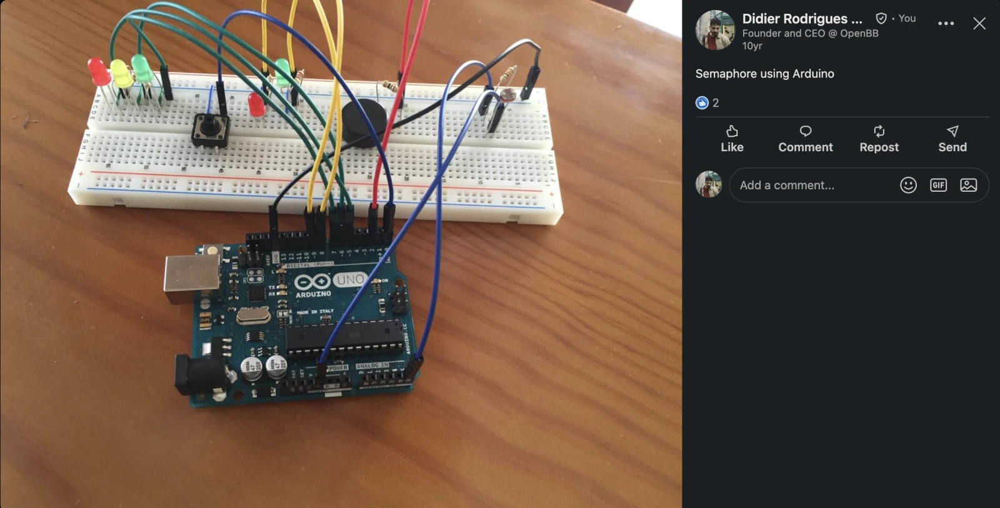
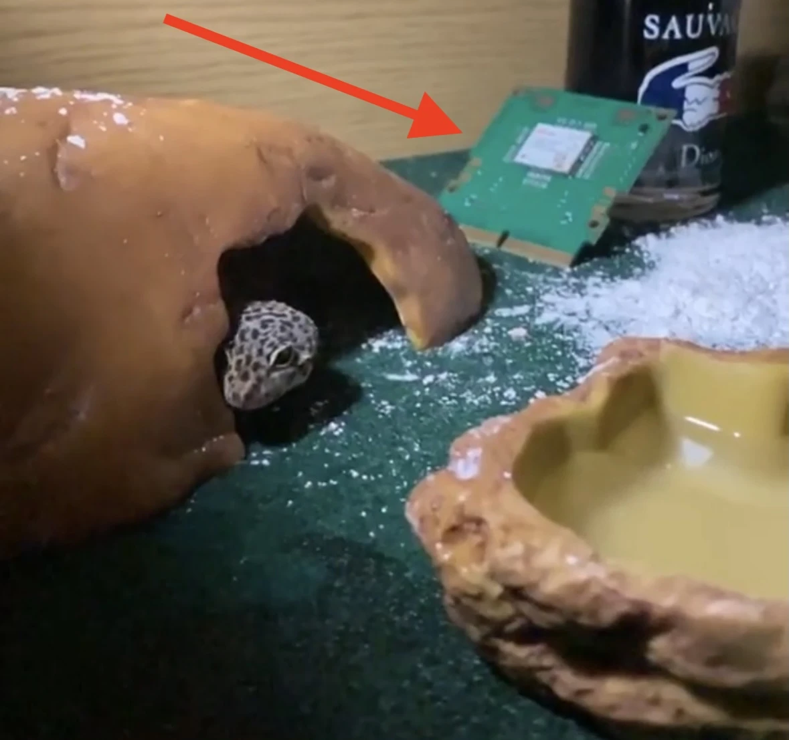

Reading firmware specs is a thing of the past. You can one-shot firmware in an afternoon now.

<!-- truncate -->

## I used to do a lot of firmware

In my BSc in Electrical and Computer Engineering we spent a lot of time close to the hardware, not just on software. Firmware in assembly and embedded C, real-time systems in Java (conveyors, sensors), and a few exotic ones like VHDL and FPGAs.

Fun fact: my very first LinkedIn post (10y ago) was about a semaphore implementation on an Arduino.

    

 

Then in my MSc in Control Systems we did more of it. We programmed a controller for a crane. We also built an inverted pendulum, which we made [move to the rhythm of Despacito](https://www.youtube.com/watch?v=EMtRAj2Rmbg) lol. And a few others.

## Then I did it for a living

My first role in industry was at u-blox as a Software Design Engineer, programming the ZED-F9K (specs [here](https://content.u-blox.com/sites/default/files/documents/ZED-F9K-02A_DataSheet_UBXDOC-304424225-18291.pdf)) for positioning in C/C++.

Here’s what a (defective) module looked like in my Leopard gecko’s terrarium.

    

 

After that I joined a startup as a Sensor Fusion Engineer, where I worked on the trackers.

    

 

Some of my biggest contributions were:

- Redesigning altitude estimation using a Kalman filter
- Adding a GNSS filtering algorithm for outliers, including a way to pick a valid start point
- Improving the soles lifespan by improving the algorithm around the FSR

## And then I stopped tinkering with firmware

OpenBB was purely software. And most of my spare time was used to build projects around OpenBB - so I didn’t have much time to spare. And Firmware takes time.

But now you can literally build anything. You buy the hardware, connect it to your laptop and ask for something to happen.

**Incredible.**

No reading specs, no watching low quality youtube videos on the topic, no having to find a niche open source project that does something somewhat similar to what you want and that you need to tinker to get there.

You just prompt it away.

We are in a **renaissance of firmware devices**.

## How it started

This all started with this tweet about the ESP32-S3 dev kit.

[https://x.com/steveruizok/status/2081120951320678422](https://x.com/steveruizok/status/2081120951320678422)

And then Steve kept posting every time someone did a cool application with an ESP32 device with a “Welcome”.

So I instantly bought one, even without having an idea of what I would build. I was sure I was going to get one soon enough. Note: I bought the Waveshare ESP32-S3 from Amazon (without batteries which was a rookie mistake!).

Before I received it, I had the idea to make it a pokedex-like device.

The idea was that I could take it for card shows, I hold the screen, say the name of a card, and it shows me the card, whether I have it or not, and its price. All based on my website [pokvault.com](http://pokvault.com).

The board itself does very little. All the heavy lifting happens on my Mac at home.

Here’s what happens when I say “Venusaur”:

1. The board records my voice and sends the clip to my Mac
2. The Mac runs STT Whisper model (locally, no cloud) to figure out which card name I said
3. There’s a post processing step that matches the word against the name of all the existing pokemon names - so that it’s not searching for “Venuesur” (particularly with my Portuguese accent) but “Venusaur”
4. It looks up cards with that name in vintage (along with their prices and if I own it)
5. It sends everything back, and the board shows it on the screen and I can use the side buttons to swipe

 

Code here if you are curious: [https://github.com/DidierRLopes/pokedex-esp32](https://github.com/DidierRLopes/pokedex-esp32)

> Thought this could be an interesting insight.
>
>  
>
> My Mac at home is connected to the Wi-Fi. And if I’m in a card show, how can I get to it from the ESP32 device?
>
>  
>
> This is where Tailscale comes in. Tailscale connects your own devices into a private network (i.e. tailnet), regardless of where they are.
>
>  
>
> This is how I use agents on my phone via Termius and Tailscale. Unfortunately, ESP32 is too small to run Tailscale so I use Tailscale Funnel - which gives the Mac a public HTTPS address, so anything with internet can reach it.
>
>  
>
> It’s public, but locked: the board requires a secret token when it connects, and nothing else on the Mac is exposed.

 

I haven’t been in a card show yet, but bought a few cards from a vendor I know and took it. And it worked really well!

I put together an introductory video (power bank in the video is because I bought the ESP32 without batteries lmao) + a real demo!

    <iframe
        src="https://www.youtube.com/embed/iQA4zREzKrE"
        width="800"
        height="400"
    />

 

Tbh a phone would have worked just fine. But it felt like I had a Pokédex at my fingertips, and that was really cool.

## A display for my brother’s dental clinic

I also bought a Ulanzi TC001 (ESP32) for my brother, who just opened a dental clinic.

It sits in his office and shows the date and time, the weather, the number of patients and a welcome message.

    <iframe
        src="https://www.youtube.com/embed/zIFb72X3uCk"
        width="800"
        height="400"
    />

 

This took less than 1h. Most of it was waiting for Codex to build and me tinkering with the UI.

Code here: [https://github.com/DidierRLopes/awtrix-ng/tree/main](https://github.com/DidierRLopes/awtrix-ng/tree/main)

## It doesn’t need to be an ESP32

It can be anything.

A few weeks ago I went very deep into my [Hermes agent setup](/blog/i-hired-hermes-as-a-member-of-lopes-staff). To give it more personality I tweaked my Divoom Ditto to sit right above my Mac mini and show a Hermes face when I use the wake word “hey Hermes”. This was all built without looking at a single line of code, via Hermes agent actually.

    <iframe
        src="https://www.youtube.com/embed/3jlF1S4csHA"
        width="800"
        height="400"
    />

## What can you build?

An ESP32 is a tiny computer with Wi-Fi and Bluetooth. Add a screen, a sensor or a microphone and you can build SO many things:

- A desk display for your calendar, portfolio or GitHub stars
- A sensor that messages you when your plants need water
- A temperature and air quality monitor for your home
- A physical button that triggers anything (e.g. your lights, a deploy)
- A voice gadget for whatever you collect or track
- A live scoreboard

 

I don’t know, maybe just ask ChatGPT/Claude:

> *“Knowing what you know about me and my interests. If I were to buy an ESP32-S3 Development Kit, what would be the most exciting projects I could build with it that could be helpful. List the top 3 with explanations on why and ideally a reference to someone that did something similar”*

## Wrap up

If you take anything from this post: buy a cheap ESP32 and tinker with it. Anything.

You’ll see how easy it is.

And if you have kids, this makes a great weekend activity.

And have fun!
